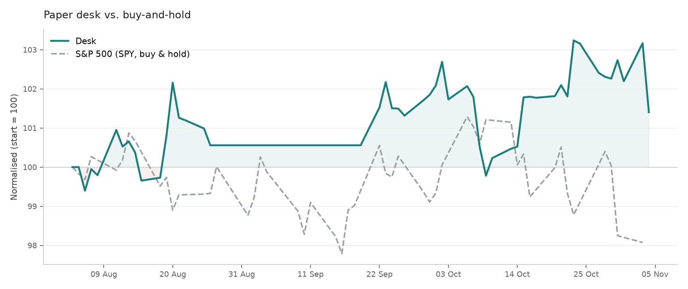

# Paper Trading Desk — Alpaca Harness

<!-- PERFORMANCE:START -->



| | Desk | SPY buy & hold |
|---|---|---|
| Return | +2.47% | -1.67% |
| Max drawdown | -2.83% | -5.86% |
| Avg. gross exposure | 34% | 100% |

*71 sessions, 46 closed trades, updated 2026-11-11.*

The desk holds cash most of the time and SPY does not, so this is not a like-for-like comparison — read it alongside the exposure row rather than as a scoreboard. SPY is dividend- and split-adjusted.

<!-- PERFORMANCE:END -->


Takes the JSON block from Claude's morning brief, enforces the risk rules, sizes
positions from the stop, submits bracket orders to an Alpaca **paper** account,
and logs everything so you can score both P&L and calibration afterwards.

Nothing in here can touch real money: it only ever talks to
`paper-api.alpaca.markets`, and every command is read-only unless you pass
`--confirm`.

---

## 1. Setup

**Account.** Sign up at [alpaca.markets](https://alpaca.markets) — a paper-only
account needs just an email address. Once in, switch the dashboard to **Paper
Trading** (top-left toggle), then generate an API key pair. The secret is shown
exactly once.

While you're there, open the paper account settings and set the starting balance
to **$100,000** to match the system prompt. Leave the account type as margin even
though the prompt specifies no leverage — shorting requires it, and the harness
enforces the cash-like constraints itself.

**Install.**

```bash
pip install --require-hashes -r requirements.txt

export ALPACA_API_KEY_ID='PK...'
export ALPACA_API_SECRET_KEY='...'
```

Put those two exports in your `~/.zshrc` or `~/.bashrc` so they persist. Keys
beginning `PK` are paper keys; live keys begin `AK`. If you ever see an `AK` key
here, stop and regenerate.

**Verify.**

```bash
python3 desk.py status
python3 desk.py check example-plays.json
```

The second command should reject the example's stale AAPL level with a warning
about distance from the last price — that's the sanity check working.

---

## 2. Daily workflow

**Morning (Stockholm time, before 15:30).** Ask Claude for the brief. It returns
prose plus a fenced `json` block. Save the whole reply — the parser finds the JSON
inside markdown fences, so you can paste the entire response verbatim:

```bash
pbpaste > briefs/2026-08-05.md          # macOS
# or just save the reply from the Claude app
python3 desk.py check briefs/2026-08-05.md
```

`check` sends nothing. It prints each play with the derived share count, the
dollar risk, the reward:risk ratio, and any rule violations. Read this before
submitting — it's where hallucinated price levels get caught.

**Submit.**

```bash
python3 desk.py submit briefs/2026-08-05.md --confirm
```

Each play goes in as a bracket order: entry, plus an attached take-profit and
stop-loss that execute unattended. This is the point of the Alpaca route — you're
asleep or at work for most of the US session and the exits still happen.

**Managing positions already open.** `plays` only opens new positions. To exit
early, or to amend or cancel an entry that has not filled, the brief's JSON
block carries a `manage` array alongside `plays`:

```json
"manage": [
  {"ticker": "LLY", "action": "close",
   "reason": "Invalidation met: the guidance raise was withdrawn on the call."}
]
```

`"action": "close"` cancels the resting orders and exits at market.
`"action": "update"` with a `stop` or a `target` replaces the live exit orders
on Alpaca (creating them if the position has none) and writes the new levels
back to `journal.csv`; `check` prints the old level next to the new one.

Since 2026-11-10 the prompt's policy is to leave an open position's bracket as
it was submitted. A position is closed only when the invalidation recorded at
entry has happened, the company's own binary event is next, or it is in its
tenth session, and no stop is tightened. Over the first 45 trades, moved stops
and closes by hand cost about 3R against leaving every bracket alone. The
harness does not enforce the policy; it measures it (section 5).

Two things `manage` deliberately does *not* do. It does not act on the prose
brief — section 3 saying "close LLY" does nothing on its own, so the model is
instructed to write both. And `no_trade: true` does not suppress it: standing
down means opening nothing new, not leaving the book unattended. Rule 1 still
applies, so widening a stop past 1% entry-to-stop risk is rejected.

**Evening or next morning.**

```bash
python3 desk.py reconcile     # pulls fills, computes R multiples
python3 desk.py score         # performance + calibration report
python3 desk.py status        # current book
```

**Weekly.** Handled automatically once CI is running — the daily session cancels
entries older than 5 days, and the cleanup job clears the rest before every
weekend and market holiday (see section 10). To do it by hand:

```bash
python3 desk.py stale --older-than 5           # list
python3 desk.py stale --older-than 5 --confirm # cancel
```

Unfilled GTC limit orders otherwise accumulate and fill weeks later on an
unrelated move, wrecking your attribution.

**Kill switch.** If `status` reports the daily loss limit breached:

```bash
python3 desk.py flatten --confirm
```

---

## 3. How sizing works

You never specify position size; Claude never specifies position size. Claude
picks a risk tier per play (`risk_pct`: 1.0 core, 0.5 half) and the harness
derives the size from it:

```
shares = floor( (equity × risk_pct) / |entry − stop| )
```

At $100k equity and 1% risk, a $5-wide stop gives 200 shares — $1,000 at risk
regardless of the share price. This removes an entire class of arithmetic error
from the model and makes rule 1 structural rather than advisory. `risk_pct` above
`risk_per_trade_pct` is cut to it; omitted, it defaults to it. The half tier is
for conviction-3 plays, counter-trend entries and rule 8's event trades. There
was a 0.25 "probe" tier until 2026-11-10; a low-conviction idea is now scored in
the shadow book at no risk instead (section 5).

The consequence worth understanding: **tight stops produce large notionals.** A
2% stop at 1% risk is a 50% position. That's correct stop-based sizing, not a
bug, but it's why `max_position_pct` and `max_gross_exposure_pct` exist as
backstops. If a play needs more than half the account's notional to express 1% of
risk, the stop is too tight for the timeframe and the harness rejects it.

---

## 4. Rules enforced

Per play — bad geometry (stop on the wrong side of entry, target inside the
stop), untradable or unshortable symbols, entry levels more than 10% from the
last traded price, sizing below one share, single-name notional over 50% of
equity, and malformed or missing probabilities. Also the universe floor: nothing
trading under `min_price` ($5), or averaging under `min_avg_volume` (1M shares a
day over 20 sessions, checked whenever consolidated history is served). And
rule 8: every play states the company's next `earnings_date`; one inside
`earnings_window_days` (7) is rejected unless it is marked `event_trade` at
`risk_pct` 0.5 or less. A play that leaves the date out is let through with a
warning that the rule was not checked.

Across the book — max 8 positions, gross exposure ≤ 150% of equity, net
exposure within ±100%, total risk at stake (entry to stop) ≤ 4% of equity, one
position per name (no adding to a name already held or resting, no duplicates in
one brief), and the 3% daily loss limit, which blocks all new submissions once
breached. Entries still resting unfilled count towards every one of these as if
they had filled.

Plays under `min_conviction` (3) are not placed. They go to the shadow book and
are scored there. The rest are admitted highest conviction first. A play that
would breach a cap is dropped on its own; the plays behind it are still
considered, so a smaller play can go in where a full-size trade did not fit. `prep` tells the model how much
room is left, including how tight a stop the remaining gross and net room allow,
since it never sees the notional its own plays will carry.

Two rules live in the prompt only. The 40% sector cap is not checked, because
the harness has no sector data; `prep` shows each position's signed share of
equity so the model can add it up. The management policy (section 2) is not
checked either: the bracket replay measures what departing from it cost.

Edit `config.json` to change any of these. Change them between runs, not
mid-experiment.

---

## 5. Reading the score report

`score` gives the usual performance stats, then the parts that matter
(figures illustrative):

```
Brackets left alone  +5.01R over 45 of these trades (as managed: +1.83R)
Moving stops and closing by hand has cost 3.18R.

CALIBRATION   43 trades with a stated probability
stated           n   mean said    actual
30%-35%         11        33%       36%
35%-40%         17        38%       41%
40%-45%         12        42%       50%
45%-50%          3        47%       33%

Brier score     0.242   (lower is better; always saying the 42% base rate scores 0.243)
```

**R is profit over the risk budgeted at entry** (`pnl_usd / risk_usd`), for
trades and shadow ideas alike. Until 2026-11-10 a trade's R was profit over its
fill-to-stop distance, which called a gap fill near its stop a loss of more
than 1R when it had lost a third of its budget. `reconcile` recomputes R for
every closed row, so the whole journal is on one definition; reports written
before that date quote the old one.

**Every trade is scored on the bracket it was submitted with.** The stated
probability was about `stop_initial` and `target_initial`, not the live levels
`manage` may have moved since, and once a stop has been moved or a position
closed by hand the fills cannot say which initial level price would have
reached first. So `shadow` replays each filled trade's initial bracket against
five-minute bars from its fill, the same way it replays a passed idea, and
records the result in `bracket_outcome`, `bracket_r` and, where the fills left
it blank, `hit_target_first`. That gives calibration its censored trades back
(20 of the first 45), and it prices `manage`: the "Brackets left alone" line is
the same trades with nobody touching them.

**The Brier score is read against the base rate, not 0.25.** If 42% of brackets
reach target first, saying 42% every time already scores about 0.24. A score at or
above that reference means the stated probabilities are not telling the better
ideas from the worse ones, whatever the bands look like.

The `thesis_verdict` column in `journal.csv` holds one of: `right thesis right
outcome`, `right thesis wrong outcome`, `wrong thesis right outcome`, `wrong
thesis wrong outcome`. The third category — profitable trades for reasons that
weren't real — is the one that will fool you if you only watch the equity
curve. The weekly review fills it in (below); a verdict written by hand is
never replaced.

### The shadow book

A trade that is never taken can never be wrong on the record, which makes
standing aside free and pushes the model towards it. So the brief puts every
idea it passes on with real levels in a `passed` array, and plays the caps drop
are added automatically. `desk.py shadow` (run at the start of every session)
replays each one against five-minute bars as if its bracket had been live: the
entry fills at its level, or at the bar's open on a gap through it, and the
exits the same way, over at most 5 sessions for the entry and 10 in total.
Where one bar holds both levels the order cannot be read and the idea is marked
ambiguous rather than guessed. Bars are consolidated (SIP) history, which the
free plan serves once it is 15 minutes old, falling back to IEX.

`score` reports the shadow book next to the real trades, with its own
calibration table and one combined with the trades. Two things to read from it:
calibration fills up several times faster than from trades alone, and a shadow
book that out-earns the trades actually taken says the filter is turning down
the better ideas.

An idea is one row per name, direction and day: the post-open review re-lists
what the morning passed on, and 25 of the first 114 rows were the same idea
counted twice. A pass that is placed later the same day is marked `taken` and
leaves the shadow book, since it is a trade. Plays under the conviction floor
arrive here as `dropped`. A dry run's plays are logged as `dry run` and
reported apart from the rest, which is how a prompt, model or effort change is
tried on a branch before it trades.

### What the model is shown of its record

`prep` puts a "Your record" section in every book state: the trades as managed,
the same trades with brackets left alone, the ideas passed on, and stated
probability against outcome in bands, with the base rate and both Brier
figures. Until 2026-11-10 it saw its last five trades and last five passes.
Each open position is listed with the thesis and invalidation written at
entry, its initial levels and how many sessions it has been open.

`prompts/lessons.md` is appended to every request: a few lines on what the
record has shown, merged by hand. Nothing writes to it automatically.

### Reviews

| | When | Run by | Writes |
|---|---|---|---|
| Weekly | Saturdays | `.github/workflows/review.yml` → `scripts/review.sh` | `reviews/weekly/<date>.md`, `thesis_verdict` |
| Monthly | 2nd Saturday | a cloud routine, following `prompts/review-monthly.md` | `reviews/<month>.md` |

The weekly review is handed the closed trades that have no verdict, with what
was written at entry, and the week's submit and research logs. It looks up what
happened to each catalyst, gives one of the four verdicts, and counts process
facts: rejections, lookups per session, `manage` instructions outside the three
allowed reasons, stops that filled far from their price. It is told not to
conclude anything about edge from a week. `desk.py verdicts` writes its verdicts
to closed rows that have none.

The monthly review tests patterns, to a stated standard: an average is given
with its n and standard error, and nothing is called a pattern below n = 20 and
two standard errors. It reports against the checkpoint in section 11 and may
propose up to three lines for `prompts/lessons.md`. Neither review edits a
prompt or a rule; that takes a commit.


---

## 6. Known limitations

**Data feed.** Free Alpaca accounts get the IEX feed, which is a single venue
carrying a small slice of consolidated volume. Quotes can differ from what you see
on a consolidated chart, especially for less liquid names. Set `"data_feed":
"sip"` in `config.json` if you subscribe to the paid feed. This affects the
harness's price sanity check, not order fills.

**Fills are optimistic.** Alpaca simulates against real-time quotes, which is
better than mid-price backtesting but still doesn't model queue position, partial
fills on size, or gap-throughs on your stop. Expect the paper equity curve to
flatter the strategy.

**Stops can fill early.** Three stops on the paper account filled 0.2 to 0.4 of
their risk short of the stop price, with no instruction having moved them: META
(closed 2026-11-04, a short's 643 stop filled at 631.99), LLY (2026-11-02) and
XLV (2026-11-05). Whatever triggered them, price had not traded at the stop.
`reconcile` flags any such fill, and it is not counted as "stop first" for
calibration: the bracket replay decides that from the tape.

**Pattern day trading.** Paper accounts simulate the PDT rule. Starting at $100k
you're clear, but if equity falls below $25,000 you'll be blocked from more than
three day trades in five sessions.

**No options, no corporate actions.** Splits and dividends don't process in paper
accounts, so anything held across an ex-date will look wrong.

**Timezone.** Alpaca timestamps are UTC; the US cash session is 15:30–22:00
Stockholm time (14:30–21:00 during the spring and autumn DST gaps, when the US and
EU shift on different dates). Bracket orders submitted while the market is closed
queue until the open, and market-type entries will fill at the opening auction
price — which on a gap is nowhere near where Claude thought it was entering. Prefer
`"entry_type": "limit"` for anything submitted overnight.

---

## 7. Files

| File | Purpose |
|---|---|
| `desk.py` | The harness. All commands. |
| `config.json` | Risk limits. Edit here, not in code. |
| `prompts/system.md` | System prompt: rules, brief format, JSON schema. |
| `prompts/daily-request.md` | The pre-market request, followed by the book state. |
| `prompts/open-request.md` | The post-open request, followed by the morning brief and the book state. |
| `prompts/lessons.md` | What the record has shown, appended to both requests. Edited by hand only. |
| `prompts/review-weekly.md`, `prompts/review-monthly.md` | Instructions for the two reviews. |
| `scripts/session.sh`, `scripts/review.sh` | One trading session; one weekly review. Both call `scripts/ask.sh` for the model run. |
| `reviews/` | Monthly reports, and weekly ones under `reviews/weekly/`. |
| `example-plays.json` | Shape reference; use with `check` to test setup. |
| `journal.csv` | Created on first submit. Your permanent decision record. |
| `shadow.csv` | Ideas passed on with levels, plays the caps or the conviction floor dropped, and dry runs, replayed against the tape. |
| `tests/` | Harness tests against a fake Alpaca; `.github/workflows/tests.yml` runs them on every push. |

Back up `journal.csv`. It's the experiment.

### Tests

```bash
python3 -m unittest discover -s tests -t .
```

Standard library only, no network, no keys, a few seconds. They run against
`tests/fake_alpaca.py`, which reproduces what the live paper API actually
returns - including the details that broke sessions in September 2026:
nanosecond timestamps, bracket stop legs held out of the open-orders list,
stop entries refused once crossed, and SIP refused inside 15 minutes. The
clock is frozen and every file lives in a temporary directory, so nothing
touches `journal.csv`, `shadow.csv`, `config.json` or `state/`. When the live
API surprises the desk again, teach the fake the new behaviour first and add
the test that would have caught it.

---

## 8. Running it unattended (GitHub Actions)

The repo ships a workflow that runs the whole session on a weekday schedule with
no machine of yours switched on. It reconciles yesterday, pulls live account
state, asks Claude for a brief, validates it, submits what passes, and commits
the brief, the validation output, and the updated journal back to the repo.

### Secrets

Repository Settings → Secrets and variables → Actions:

| Secret | Value |
|---|---|
| `ALPACA_API_KEY_ID` | Your paper key (`PK...`) |
| `ALPACA_API_SECRET_KEY` | Your paper secret |
| `CLAUDE_CODE_OAUTH_TOKEN` | Run `claude setup-token` locally and paste the result |

`claude setup-token` produces a long-lived token that authenticates against your
Pro subscription — no API key and no per-token billing. It's valid for about a
year, so put a calendar reminder to regenerate it.

To use API billing instead, swap the secret for `ANTHROPIC_API_KEY` and change the
env block in `.github/workflows/desk.yml` to match.

### Schedule

GitHub's own `schedule` trigger is not used. On this repo it fired 4-6 hours
late every day, which put every scheduled session past the open. The workflows
are started by `workflow_dispatch` from [`dispatch/`](dispatch/README.md)
instead, which begins within seconds:

a **Cloudflare Worker cron**: the pre-market brief at 08:55 ET and the post-open
review at 09:55 ET on weekdays, and the cleanup at 15:40 ET, also every weekday
but acting only on the last session before a break (section 10) - each 10 min
ahead of its job's target. The weekly review is the exception: it runs on
GitHub's own cron, since nothing about a Saturday review depends on the hour. There is no backup trigger;
a failed dispatch is a missed session unless you re-run it by hand inside its
window. In the Actions tab each run is titled with its session.

Both desk sessions run `desk.yml`, told apart by its `session` input. The
pre-market brief holds until 25 minutes before the open, derived from Alpaca's
calendar, and the guard (`calendar --before-open 5`) stands it down rather than
write a "pre-market" brief with the market already trading. The post-open
review holds until 35 minutes after the open, once the 10:00 ET releases are out
and the opening range has formed, and its guard (`calendar --open-window 30
120`) stands it down outside that stretch. A missed session costs one data
point; an inconsistent information set costs the comparability of the whole
record.

The review reads the morning's brief, sees the fills and the open, and can
manage, cancel and open positions under the same rules. After it nothing looks
at the book until the next morning.

### The model run

Three things are pinned, because each is part of the experiment: the model
(`DESK_MODEL`, `claude-opus-5-5`, not the `opus` alias), the reasoning effort
(`DESK_EFFORT`, `xhigh`) and the Claude Code version (in the install step).
`desk.yml` and `review.yml` carry the same values and a test holds them equal.
Every journal and shadow row records `model/effort`. Changing any of them is a
change to the experiment: try it as dry runs on a branch first, where its plays
are scored in the shadow book under their own label, and note it in section 11.
Until 2026-11-10 no effort was set and a whole session, research included, took
one to two and a half minutes.

`scripts/ask.sh` is the only place the model is called. It runs with
`--tools "WebSearch,WebFetch"`, so those are the only tools that exist for it:
it cannot read or write a file or run a command. The Alpaca keys are removed
from its environment, and `--system-prompt` replaces Claude Code's coding-agent
prompt with `prompts/system.md`. Before 2026-11-10 the run had the default tool
set with edits pre-approved, inside a checkout that held `desk.py` and the
keys, while reading web pages.

The run's transcript is split by `desk.py transcript` into the brief and
`briefs/<date>.research.txt`, which lists every search and page fetched. A
brief written with no lookups at all is kept for the record and not acted on.

Duplicate triggers are harmless. They queue behind the `trading-desk`
concurrency group and exit on `briefs/<date>.submit.txt` (or
`briefs/<date>-open.submit.txt` for the review), which is written only after a
real submit. Dry runs don't create it. To force a re-run, delete that file.

`workflow_dispatch` also lets you trigger a run by hand from the Actions tab
(dry run by default). **Do that first**, before trusting the dispatcher - it's
the fastest way to find a missing secret.

### What each run commits

```
briefs/2026-08-05.md          full prose brief + JSON block
briefs/2026-08-05.research.txt  every search and page the model fetched for it
briefs/2026-08-05.check.txt   validation: what was approved, what was rejected, why
briefs/2026-08-05.submit.txt  what actually reached the account
briefs/2026-08-05-open.*      the same four for the post-open review
journal.csv                   updated with fills and R multiples
shadow.csv                    passed ideas and dropped plays, replayed and scored
state/                        book state, request, score
```

The brief is committed **before** outcomes are known. That timestamp is the whole
value of running this in public — it's a preregistration you can't quietly revise.
Don't rewrite history in this repo, even to fix a typo in a thesis.

### Failure modes to watch

The `calendar` guard checks Alpaca's market calendar and stands the session down
on US holidays, so you won't get briefs written into a closed market.

The failure worth actually watching for is **thin research**. If `WebSearch`
stops working in CI, or the model simply does not use it, you won't get an
error — you'll get a confident brief written from stale training data, and
since `prep` supplies the prices, its levels will look fine. The research log
is the check: its first line is the number of lookups, a session with none
fails, and the weekly review reports any session under ten.

The desk **shares the subscription's usage limit** with everything else signed
in to the same account. On 2026-11-10 the open session failed at preflight in
two seconds while an interactive Claude Code session on the account was at its
limit. A session lost this way places nothing and manages nothing; the brackets
already at the broker are unaffected. Preflight and `desk.py transcript` now
raise claude's own error text as an annotation, so the cause is on the run's
summary page. If it recurs, give the desk its own credential (the
`ANTHROPIC_API_KEY` secret takes precedence when set).

Set up email notification for failed workflow runs (GitHub Settings →
Notifications → Actions). A run that dies at 12:00 UTC while you're on holiday is
otherwise invisible until you come back.

---

## 9. The performance chart

`desk.py chart --update-readme` snapshots equity, redraws the curve, and rewrites
the block between the `PERFORMANCE` markers at the top of this file. It runs at
the end of every session, so the chart in the README is never more than a day
stale.

Equity comes from Alpaca's portfolio history endpoint, which is daily
mark-to-market including open positions — so the curve reflects unrealised P&L,
not just closed trades. A local copy is also appended to `state/equity.csv` each
run, which is what the chart falls back to if the endpoint is unavailable, and
what the average-exposure figure is computed from.

The benchmark is SPY, split- and dividend-adjusted, normalised to the same
starting value.

### Reading it honestly

**The comparison is not like-for-like, and the exposure row is what tells you
so.** The desk holds at most eight positions and is frequently in cash; SPY is
100% invested at all times. If the desk returns half of SPY at a third of the
exposure, that is not underperformance — it's less risk taken. If it matches SPY
while fully invested, that's just beta, and you could have had it for free.

This is why the chart carries a **PRELIMINARY** watermark until 30 sessions and
20 closed trades. A rising line over three weeks is noise that happens to look
like skill, and a chart is far more persuasive than the number of samples behind
it justifies. The watermark disappears on its own once the sample supports
looking at it.

Even then, the equity curve is the *last* thing that becomes informative. The
calibration table in `desk.py score` tells you whether the model knows what it
knows, and it starts meaning something around twenty trades — long before the
P&L does.

---

## 10. Weekend cleanup (`.github/workflows/weekend.yml`)

A second workflow runs 10 minutes before the US close (15:50 ET) on the last
session before any day the market is shut, and cancels **every** unfilled entry
order, regardless of age. It is dispatched every weekday and
`desk.py calendar --before-break` decides whether to act: Fridays alone missed
the Fridays that are themselves holidays (2026-12-25, 2027-01-01) and every
midweek one. On the half-day after Thanksgiving it runs after the 13:00 ET
close instead, which still clears the book before Monday.

This is a deliberately different policy from the daily session, which only
cancels entries older than 5 days. The weekend case is specific: an order resting from Friday can fill on Monday's open into a thesis
written before two days of news it never saw. The price gets honoured; the
reasoning behind it doesn't. Cancelling and letting Monday's brief re-propose the
idea, if it still holds, keeps every filled trade tied to reasoning that was
current when it filled.

It shares a `concurrency` group with the daily session, so the two can never run
simultaneously. `workflow_dispatch` defaults to a dry run that lists what would
be cancelled without touching anything.

If you'd rather let entries survive the weekend, delete the file. The daily
age-based cleanup is independent.

### Never-filled entries

Cancelling raises a question the journal has to answer: what is a play that was
proposed but never entered?

It's a prediction that didn't become a trade. `reconcile` now marks these with
`exit_reason = "never filled"` so they don't sit in the journal looking like open
positions, and they're excluded from win rate, expectancy, and calibration — you
cannot score whether price hit a target from an entry you never took.

But the *rate* is worth watching, so `score` reports it:

```
Entry fill rate  33%  (1 filled / 3 proposed, 2 never reached)
```

A low fill rate is diagnostic in a way the P&L isn't. It means the entry levels
are being set somewhere price doesn't go — too far below the market on longs,
waiting for pullbacks that never come. That's a fixable flaw in how the model
picks levels, and it's entirely invisible if you only look at the trades that
did fill.

---

## 11. Changes to the experiment

Changes to the prompt, the rules or the harness make sessions before and after
them different experiments. They are listed here by the first session they
apply to, so the record can be read in segments.

**2026-09-23**

- *Timing.* Since 2026-08-18 the brief has run at 09:05 ET, but the request still
  told the model it was writing before the 08:30 ET releases, and it discarded
  prints it found as a result (CPI on 2026-09-11). `prep` now states the current
  time and that anything scheduled before it has printed.
- *Rule 8* now covers the company's own binaries only. Macro releases, FOMC and
  other companies' earnings are ambient risk, handled with stop and tier. It had
  been read as covering any macro event inside five days, which is nearly always.
- *Risk tiers* (`risk_pct` 1.0 / 0.5 / 0.25), gross 150% with net ±100%, total
  open risk ≤ 4%, 8 slots, admission by conviction. Previously 1% flat, gross
  100%, 5 slots, and one cap breach blocked every new play in the brief.
- *Prompt.* Both sides named every session; conditional plans are placed as
  orders, or left for the post-open review with their levels; standing aside is
  no longer framed as the default-correct answer; the account is described as
  margin, not cash.
- *Scoring fix.* `reconcile` missed any exit that `manage` had replaced or
  re-placed, and measured R against the live stop instead of the one submitted.
  LLY (2026-08-05, stopped at about 1229.76 on 2026-08-25, about +1.76R) was
  missing from the record the model was shown each morning, which read 0W/2L.
- *Model pinned* to `claude-opus-5-5` (previously the `opus` alias, which
  resolved to whatever the pinned CLI version shipped with). Journal rows now
  record `model` and `session`.
- *Market data.* `prep` appends an Alpaca table to the book state: last trade,
  prior close, ATR, 20/50-day averages, 20-day range and 5-day change for held
  and resting names, a watchlist (`config.json`), and the day's movers filtered to
  the tradable universe. Until now the model found every price by web search.
- *Shadow book.* Passed ideas and dropped plays are replayed and scored
  (section 5).
- *Post-open review.* A second session at 10:05 ET (section 8). Before this the
  brief was the only decision point, and 19 of 24 no-trade briefs deferred their
  decision to "after the open or the data", which nothing ever acted on.
- *Stop entries past their trigger* (from the 2026-09-23 run). A sell stop at
  BAC 55.90 was refused because pre-market had already traded 55.885; the run
  failed and the prompt had wrongly said such an order fires at the open. It is
  now recorded as not placed, scored in the shadow book and shown to the
  post-open review. The market table's last price now also comes from the
  consolidated tape 15 minutes delayed (free on the basic plan) when that is
  more recent than the IEX print, which is thin before the open, and the movers
  screener is labelled when it is still the previous session's.

**2026-09-24 - nothing executed**

Both sessions ran and wrote briefs, but `check` crashed before submitting (a
timestamp-parsing bug from the 2026-09-23 changes), so none of that day's plays
or `manage` instructions reached Alpaca. The briefs stay in the record as
written. Fixed the same day. The book state had also been reporting filled
brackets' stops as "no live order": Alpaca holds a bracket's stop leg while the
take-profit works, and the open-orders list does not return it, so missing legs
are now looked up on the entry order.

**2026-09-25 - no Friday session, and the Friday cleanup ran on Thursday**

The Cloudflare crons used numeric weekdays, which Cloudflare counts from
1 = Sunday: `1-5` was Sunday-Thursday and `5` was Thursday. Neither Friday
session dispatched (the systemd backup was off, and caught up on Saturday,
where the calendar guard stood it down), and the weekend cleanup ran on
2026-09-24 instead, cancelling AAPL's resting 346 breakout entry a day early.
The crons now name their days. Every Friday since the move to Cloudflare
(2026-09-19) was affected; 2026-09-25 was the first.

**2026-09-28 - systemd backup trigger removed**

Cloudflare is the only dispatcher. The systemd timers on the operator's
desktop caught up on waking - once per timer, not once per missed day - and a
weekend-cleanup catch-up landing midweek would cancel every resting entry.
Desk runs in the Actions tab are now titled by session.

**2026-10-20**

- *Clock.* The book state's "Time now" line states Stockholm time as well, and
  the prompt takes it from there. The brief had assumed ET + 6h from memory,
  which is wrong for the weeks when the EU and US clocks are an hour apart.

**2026-11-10 - review of the first 45 trades**

Applies from the first session after this was merged (`git log` has the date).
What the review found, as of 2026-11-09:

- 45 closed trades at +0.04R each, with a standard error of 0.17R: no measurable
  edge either way. Passed ideas averaged +0.10R over 80.
- Replaying each trade's bracket as submitted: left alone, the 45 trades make
  about 5R; as managed, 1.8R (both in R as it was then defined). Moved stops
  (11 trades) and closes by hand (9) account for the difference.
- Stated probabilities sat between 0.30 and 0.47, on average exactly at
  breakeven for the stated reward:risk, and scored no better than the base rate
  (Brier 0.242 against 0.243 on all 43 scorable trades).
- Before 2026-09-23, 3 of 27 morning briefs proposed a play; since then, 31
  of 32. Of the 73 plays placed, 72 were at conviction 2 or 3 and 69 at half
  size or less. Conviction 2 averaged -0.15R over 18 closed trades, conviction
  3 +0.11R over 26.
- A whole session, research included, took about two and a half minutes for
  the brief and just over one for the review, of a twenty-minute window, at
  whatever effort the CLI defaulted to.
- 71 of 73 trades were watchlist names. The movers table meant to widen that
  showed the previous session's small caps before every open.
- The model ran with file-editing tools pre-approved, in a checkout holding
  `desk.py`, with the broker keys in its environment.

None of the performance figures is statistically settled. The changes follow
the point estimates where acting on them is cheap to reverse, and otherwise fix
the measurement so that the next review can tell.

What the model is told:

- *No quota.* The lines asking for a position most sessions and for
  low-conviction views to go on as probes (added 2026-09-23) are gone. The 0.25
  tier is gone. Plays under conviction 3 are scored in the shadow book, not
  placed (`min_conviction`).
- *Management.* The bracket is left as submitted. Close only on the recorded
  invalidation, the company's own binary event, or the tenth session. No stop
  is tightened.
- *Probability.* Stated for the bracket as submitted, within ten sessions,
  starting from the base rate shown in the book state.
- *Research in two passes*: the tape, then each candidate's catalyst at its
  source, its earnings date, how far it has moved, and its price.
- *Horizon* 1 to 5 sessions, 10 at most (was 1 to 5; 11 of 43 brackets took
  longer than 5 to resolve).
- The end-of-day log section, which nothing ever requested, is removed.

What the model is given:

- *Its record*, cumulative and scored on brackets as submitted, in place of its
  last five trades and passes. `prompts/lessons.md` on every request.
- *Each position's* thesis and invalidation in full, initial levels, sessions
  open and share of equity.
- *Yesterday's post-open review*, in the pre-market request.
- *Movers* from a fixed list of about 270 liquid large caps (`scan` in
  `config.json`) at today's prices, replacing the screener.

How it is run:

- *Effort pinned* at `xhigh` beside the model; the journal records both. CLI
  2.1.321. Up to 80 turns and 25 minutes.
- *Tools* restricted to web search and fetch, broker keys out of the model's
  environment, Claude Code's own system prompt replaced (section 8).
- *Research log* per session, and a brief with no lookups is not acted on.
- *Alpaca reads retry* on timeouts, 429 and 5xx. Writes do not.
- *Cleanup* before every closed day, not only weekends (section 10).

How it is scored:

- *R* is profit over the risk budgeted, for every row (section 5). Closed
  trades were recomputed: the 45 average +0.07R on this definition.
- *Bracket replay* for every trade: `bracket_outcome`, `bracket_r`, and
  calibration for the trades `manage` had censored.
- *Calibration* in 5-point bands where the probabilities actually sit, read
  against the base rate.
- *Shadow book* deduplicated per name, direction and day; passes that were
  later placed are not counted as passes.
- *Dry runs* log their plays to the shadow book under their own label.

What the harness newly enforces: the conviction floor, the price and volume
floor of the tradable universe, and rule 8 from the play's own `earnings_date`.

Reviews: a weekly review in CI that writes thesis verdicts and counts process
facts, and a versioned prompt for the monthly one (section 5).

*Checkpoint.* Decided at the first monthly review after 40 trades opened under
these rules have closed, on the figures `score` and the weekly reviews give:

1. *Management.* If more than 1 in 10 of those trades had a `manage` close or
   level change outside the three allowed reasons, the prompt is not holding
   and the policy moves into `validate_manage`. Otherwise it stays as it is.
2. *Conviction floor.* Once 20 ideas at conviction 1 or 2 have resolved in the
   shadow book: the floor is removed if they out-earn the trades placed by more
   than two standard errors of the difference, and kept otherwise.
3. *Research.* If the median pre-market session made fewer than 10 lookups, or
   more than 1 play in 10 came without an `earnings_date`, `--min-research` is
   raised and the missing date becomes a rejection.
4. *Probabilities.* If the Brier score on ideas since the change is still at or
   above its base-rate reference at n = 80, stop asking for a per-play
   probability to be argued and show the base rate alone.
5. *Activity.* If fewer than one morning brief in three proposes a play that
   is placed, the desk has swung back to standing aside, as before 2026-09-23,
   and the prompt's STANDING ASIDE section is rewritten.
6. *Result.* Expectancy since the change is reported with its standard error
   and not acted on. Forty trades cannot tell +0.04R from +0.11R; that needs
   something like a thousand.

Not changed: the caps, sizing, order types, the two decision points and their
timing, the watchlist, and the model.
